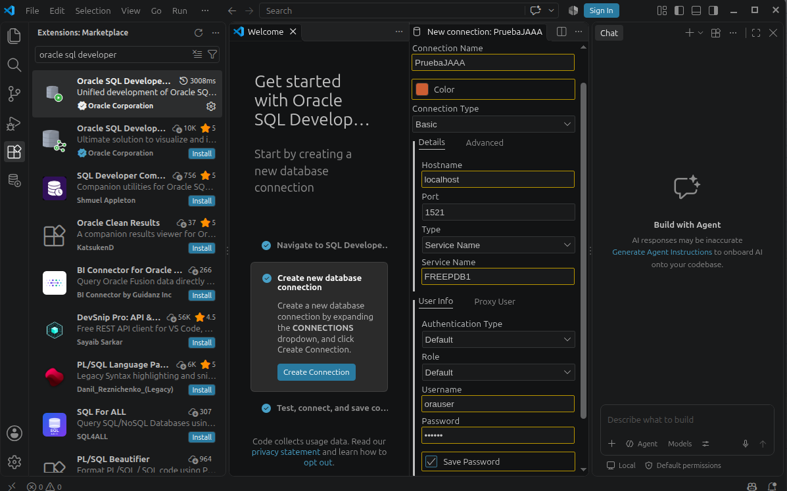
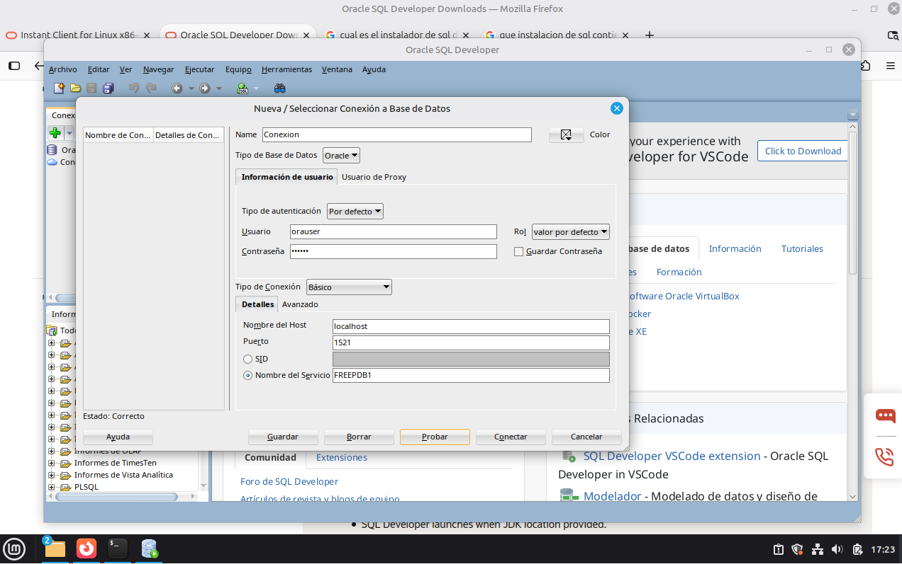

# Practica-2.3-instalar-clientes-de-3-SGBD-

### 1. Qué clientes instalaste, sus versiones, de dónde los obtuviste y qué dependencias necesitaron.

Instale los clientes de Oracle (Version_23_26), PostgreSQL, MariaDB y DBeaver respectivamente. 

| Clientes | Versiones | ¿Donde se obtuvo? | Dependencias |
| --- |  --- | --- | --- |
| Oracle SQLcl |  26.0.23 | [Web de oracle](https://www.oracle.com/database/sqldeveloper/instantclient/linux-x86-64-download.html) | Java |
| Oracle SQL Developer |  26.0.23 | [Web de oracle](https://www.oracle.com/database/sqldeveloper/instantclient/linux-x86-64-download.html) | JDK, unzip |
| PostgreSQL psql | 26.3 | [Repositorio pgadmin](https://www.pgadmin.org/download/pgadmin-4-apt/) | postgresql-client |
| PostgreSQL pgadmin4 | 26.3 | [Repositorio pgadmin](https://www.pgadmin.org/download/pgadmin-4-apt/)n | curl, gnupg |
| MariaDB mariadb |  15.1 | apt (Descarga mediante Consola) | mariadb-client |
| MariaDB phpMyAdmin |  15.1 | apt (Descarga mediante Consola) | apache2, php |
| DBeaver |  26.2.3 | [Web de DBeaver](https://dbeaver.io/download/) | Java/JDBC |


### 2. Cómo instalaste o configuraste cada uno, con los comandos realmente utilizados.

***Configuración de Oracle Developer (y de java):***
```bash
sudo apt update
sudo apt install default-jdk unzip
java --version

sudo unzip instantclient-basic-linux.x64-23.26.3.0.0.zip -d /opt//opt/sqldeveloper/sqldeveloper.sh
```
![Configuración del cliente grafico] Evidencias/Captura de pantalla 2026-10-19 172315.png


***Configuración del cliente de VS (Tambien de OracleSQL Developer):***
```bash
cd ~/Descargas
sudo apt install ./code_1.142.0-17920350033_amd64.deb
```


***Configuración del cliente de terminal SQL*Plus:***
```bash
sudo apt update
sudo apt install unzip libaio1t64

sudo ln -s /usr/lib/x86_64-linux-gnu/libaio.so.1t64 /usr/lib/x86_64-linux-gnu/libaio.so.1

sudo mkdir -p /opt/oracle 

# Esto lo realice a parte, debido a un error que cometí durante el ejercicio (más información en el ejercicio 3) 
sudo unzip ~/Descargas/instantclient-basic-linux.x64-23.26.3.0.0.zip -d /opt/oracle/
sudo unzip ~/Descargas/instantclient-sqlplus-linux.x64-23.26.3.0.0.zip -d /opt/oracle/

echo "/opt/oracle-client/instantclient_23_26" | sudo tee /etc/ld.so.conf.d/oracle-instantclient.conf

sudo ldconfig

echo 'export PATH=/opt/oracle-client/instantclient_23_26:$PATH' >> ~/.bashrc

source ~/.bashrc

# Verificar versión
sqlplus -v

# Realizar Conexión
sqlplus orauser@//localhost:1521/FREEPDB1
```



***Configuración del cliente de terminal psql (PostgreSQL):***
```bash
cd ~/Descargas

sudo apt update
sudo apt install postgresql-client
psql --version
psql -h localhost -U pguser -d dbpg -W
```


***Configuración del cliente gráfico pgAdmin 4 (PostgreSQL):***
```bash
curl -fsS https://www.pgadmin.org/static/packages_pgadmin_org.pub | sudo gpg --dearmor -o /etc/apt/keyrings/packages-pgadmin-org.gpg

sudo sh -c 'echo "deb [signed-by=/etc/apt/keyrings/packages-pgadmin-org.gpg] https://ftp.postgresql.org/pub/pgadmin/pgadmin4/apt/noble pgadmin4 main" > /etc/apt/sources.list.d/pgadmin4.list && apt update'

sudo apt install pgadmin4-desktop
```


***Configuración del cliente de terminal mariadb (o mysql)):***
```bash
sudo apt update
sudo apt install mariadb-client
mariadb --version
mariadb -h localhost -u muser -p dbm
```

***Configuración del cliente web phpMyAdmin (MariaDB):*** 
```bash
sudo apt update
sudo apt install apache2 php php-mysql php-mbstring php-zip php-gd php-curl phpmyadmin
sudo phpenmod mbstring
sudo systemctl restart apache2

sudo a2enconf phpmyadmin
sudo systemctl reload apache2
```

**En la terminal ponemos lo siguiente:**
```
sudo mariadb

CREATE USER 'adminphp'@'localhost' IDENTIFIED BY 'maria';
GRANT ALL PRIVILEGES ON *.* TO 'adminphp'@'localhost' WITH GRANT OPTION;
FLUSH PRIVILEGES;
EXIT;
```


***Configuración del DBeaver:***
```bash
cd ~/Descargas
sudo apt install ./dbeaver-ce-26.2.3-linux-x86_64.deb
sudo dpkg -i dbeaver-ce-26.2.3-linux-x86_64.deb
```


### 3. Una prueba de conexión con un cliente de consola y otro gráfico o web para cada SGBD. Indica servidor, puerto, base o servicio y usuario, pero nunca la contraseña.

(Prueba de conexión del cliente de cliente)[]
- Servidor
- Puerto
- Servicio
- Usuario
  
(Prueba de conexión del cliente de cliente)[]
- Servidor
- Puerto
- Servicio
- Usuario
  
(Prueba de conexión del cliente de cliente)[]
- Servidor
- Puerto
- Servicio
- Usuario
  
(Prueba de conexión del cliente de cliente)[]


### 4. Qué problemas surgieron y cómo los resolviste; si alguno de los clientes no llegó a funcionar, incluye el error y las comprobaciones realizadas.

**1. Asunto de la conexión con los repositorios (Problemas con los paquetes relacionados a libaio1)**

Es uno de los pocos problemas que tuve (sorprendentemente no fue un problema relacionado con Java), durante la extracción y la lectura del archivo ```libaio1``` daño el sistema de paquetes de linux, razón por la cual, el proceso afecto también a los repositorio relacionados al proceso apt. Para recuperar la función de apt, decidí usar los siguientes comandos

### 5. Las fuentes consultadas y, si usas capturas o salidas de terminal, una explicación breve de qué demuestra cada una.
Las fuentes consultadas fueron el documento indicado: https://informatica.iesalbarregas.com/pluginfile.php/15395/mod_assign/introattachment/0/Practica_Instalar_Clientes_3_SGBD.pdf?forcedownload=1


